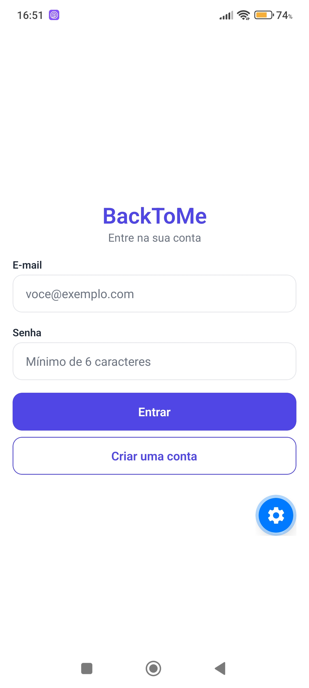
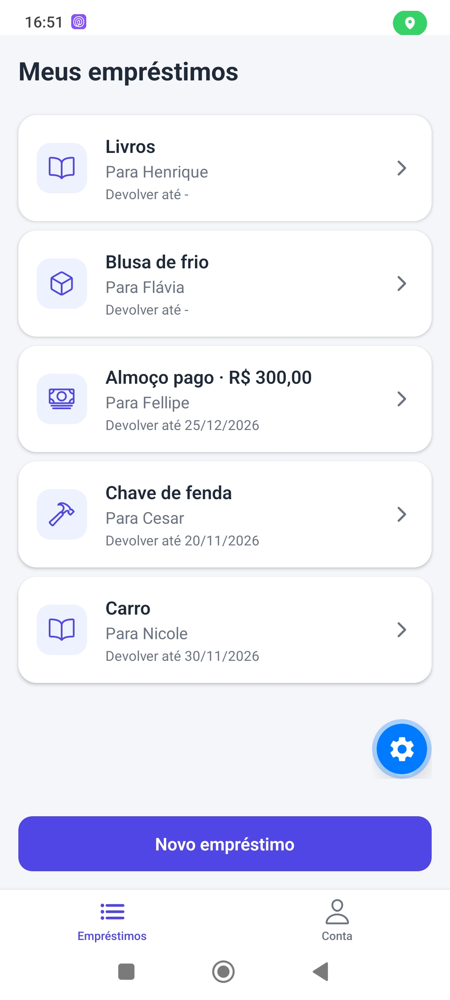
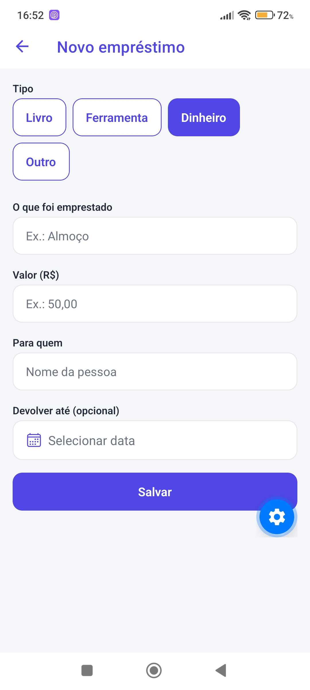
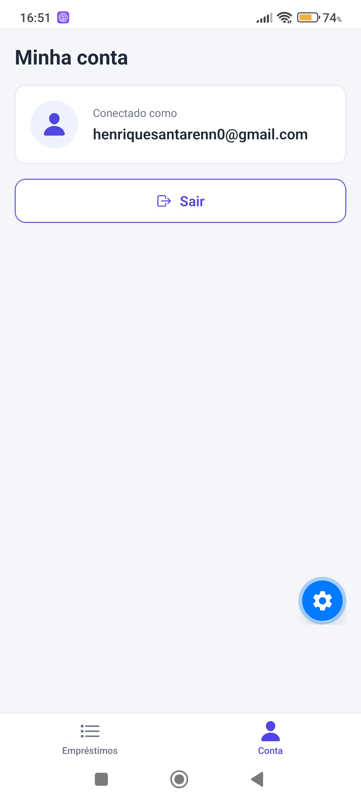

# BackToMe

Aplicativo mobile feito em **React Native (Expo)** com **Firebase** para controlar **empréstimos pessoais**: registre o que você emprestou, para quem, e até quando precisa voltar para você (*back to me*).

Projeto Final da disciplina de desenvolvimento mobile.

## Problema, público e funcionalidades

- **Problema:** esquecer o que foi emprestado, para quem e quando deveria ser devolvido.
- **Público-alvo:** qualquer pessoa que empresta livros, ferramentas, dinheiro ou outros objetos para amigos, família e colegas.
- **Funcionalidades:**
  - Criar conta e entrar com e-mail e senha (Firebase Authentication). A sessão fica salva no celular.
  - Cadastrar empréstimos com tipo (livro, ferramenta, dinheiro ou outro), item, pessoa, valor (quando for dinheiro) e data de devolução opcional.
  - Seletor de data nativo e validação dos campos do formulário.
  - Lista de empréstimos em tempo real (Firestore), com marcação de **devolvido** e **exclusão** com confirmação.
  - Estado global compartilhado entre as telas, com mensagens de feedback (carregando, sucesso e erro).
  - Navegação por abas: **Empréstimos** e **Conta** (e-mail do usuário e botão de sair).

## Capturas de tela

| Login | Empréstimos | Novo empréstimo | Conta |
| --- | --- | --- | --- |
|  |  |  |  |

## Tecnologias

- React Native 0.88 + Expo SDK 58 (JavaScript)
- React Navigation: Native Stack e Bottom Tabs
- Context API + `useReducer` (estado global) e `useState` (estado local dos formulários)
- Firebase Authentication e Cloud Firestore (banco NoSQL)
- `@react-native-community/datetimepicker` (seletor de data nativo)
- `@expo/vector-icons` (ícones vetoriais)
- `@react-native-async-storage/async-storage` (sessão salva no aparelho)

## Como instalar e executar

### Pré-requisitos

- [Node.js](https://nodejs.org/) LTS recente (versão 20 ou superior)
- Git
- App **Expo Go** no celular (Android ou iOS) ou um emulador

### Passo a passo

1. Clone o repositório e entre na pasta:

   ```bash
   git clone https://github.com/nicolesantos746/BackToMe.git
   cd BackToMe
   ```

2. Use a branch `develop`, que reúne as funcionalidades integradas:

   ```bash
   git checkout develop
   ```

3. Instale as dependências:

   ```bash
   npm install
   ```

4. Crie o arquivo `.env` a partir do exemplo e preencha com as chaves do seu projeto Firebase (veja a próxima seção):

   ```bash
   cp .env.example .env
   ```

5. Inicie o app:

   ```bash
   npx expo start
   ```

   Abra o app **Expo Go** e escaneie o QR Code (no Android, pelo próprio Expo Go; no iPhone, pela câmera). Também é possível pressionar `a` para abrir no emulador Android.

> Se alterar o `.env` com o servidor ligado, reinicie com `npx expo start -c`. Se o celular e o computador não estiverem na mesma rede Wi-Fi, use `npx expo start --tunnel`.

### Configuração do Firebase (projeto de teste)

O arquivo `.env` **não vai para o GitHub** (está no `.gitignore`). Cada pessoa cria o seu a partir do `.env.example`.

1. Acesse o [Console do Firebase](https://console.firebase.google.com/) e crie um projeto.
2. Em **Build > Authentication > Sign-in method**, ative o provedor **E-mail/senha**.
3. Em **Build > Firestore Database**, clique em **Criar banco de dados**.
4. Em **Configurações do projeto > Seus aplicativos**, registre um app **Web (`</>`)** e copie os valores do `firebaseConfig`.
5. Cole os valores no `.env`:

   | Variável | Valor do `firebaseConfig` |
   | --- | --- |
   | `EXPO_PUBLIC_FIREBASE_API_KEY` | `apiKey` |
   | `EXPO_PUBLIC_FIREBASE_AUTH_DOMAIN` | `authDomain` |
   | `EXPO_PUBLIC_FIREBASE_PROJECT_ID` | `projectId` |
   | `EXPO_PUBLIC_FIREBASE_STORAGE_BUCKET` | `storageBucket` |
   | `EXPO_PUBLIC_FIREBASE_MESSAGING_SENDER_ID` | `messagingSenderId` |
   | `EXPO_PUBLIC_FIREBASE_APP_ID` | `appId` |

6. Em **Firestore > Regras**, cada usuário acessa apenas os próprios empréstimos:

   ```
   rules_version = '2';
   service cloud.firestore {
     match /databases/{database}/documents {
       match /users/{userId}/loans/{loanId} {
         allow read, write: if request.auth != null && request.auth.uid == userId;
       }
     }
   }
   ```

Os empréstimos ficam em `users/{uid}/loans`, com os campos `itemType`, `itemName`, `borrowerName`, `amount`, `dueDate`, `returned`, `returnedAt` e `createdAt`.

## Estrutura do projeto

```
App.js                   Autenticação, provider do estado global e navegação (Stack)
src/
  components/            Componentes reutilizáveis (Button, Input, DateField, LoanCard,
                         EmptyState, Loading, FeedbackBanner)
  constants/             Tipos de empréstimo
  context/               Estado global: reducer, LoansContext e hook useLoans
  navigation/            Bottom Tabs (Empréstimos e Conta)
  screens/               LoginScreen, HomeScreen, AddLoanScreen, AccountScreen
  services/              Configuração do Firebase e CRUD no Firestore
  theme/                 Cores, espaçamentos e tipografia
  utils/                 Formatação de datas e valores
```

## Git Flow

- `main`: versão estável da entrega.
- `develop`: integração das funcionalidades.
- `feature/*`: uma branch por funcionalidade, integrada na `develop` por Pull Request com revisão de outro integrante e merge commit.

Pull Requests integrados na `develop`:

1. `feature/base-componentes`
2. `feature/firebase`
3. `feature/formulario-recursos-nativos`
4. `feature/estado-global`
5. `feature/bottom-tabs`

## Divisão das tarefas e integrantes

| Integrante | Branch | Responsabilidade |
| --- | --- | --- |
| Fellipe Hiago Torres Batista | `feature/bottom-tabs` | Navegação com Bottom Tabs, tela de conta e este README |
| Nicole | `feature/base-componentes` | Repositório, projeto Expo base, tema, tipos de empréstimo, formatação e componentes reutilizáveis (Button, Input, LoanCard, feedback e estado vazio) |
| Henrique | `feature/firebase` | Integração com o Firebase (autenticação e CRUD no Firestore), `App.js` com controle de login, telas de Login, Home e Novo empréstimo e navegação Native Stack |
| Flavia | `feature/estado-global` | Estado global com Context API + `useReducer`, `LoansProvider`, hook `useLoans` e mensagens de feedback |
| Cesar | `feature/formulario-recursos-nativos` | Formulário de empréstimo, validação e seletor de data nativo (`DateTimePicker`) |

## Vídeo demonstrativo

> Link do vídeo (3 a 5 minutos): _adicionar aqui_
